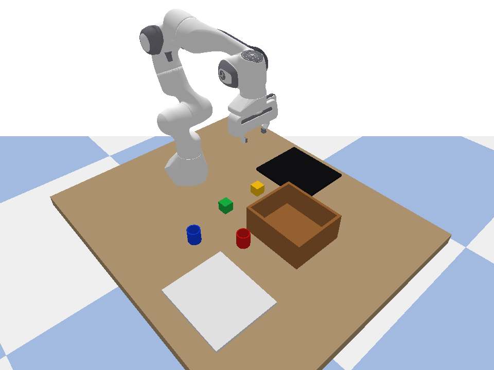
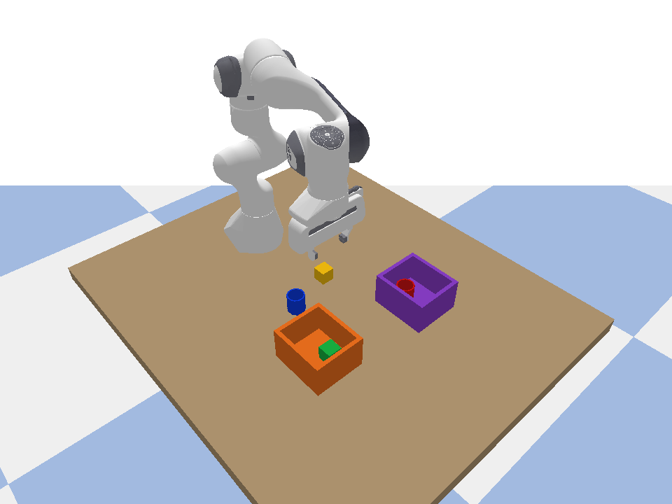

# When2Ask — Clarification Timing for Robotic Task Execution

真实 PyBullet / Franka Panda 的澄清时机研究工程。保留 Scripted MVP、共享 DeepSeek Planner 与 DeepSeek/Jev Gate；Phase 3 增加场景分组的 Dev/Test、双容器任务和真实 Dev 阈值校准。没有模型训练。

新增 [实时任务控制台](docs/local_console.md)：`python console.py --live` 后访问 **http://127.0.0.1:8877/**。可选择任务、NoAsk/LLM-Gate/Jev-Gate 与自动/手动回答，并行观看独立 Panda 场景。控制器与物理 worker 已通过本机 HTTP 联调，双机 VPN 尚未实测。[真实运行证据](outputs/console_evidence/README.md) 独立保存，不修改冻结实验。

控制台现已升级为 **Robot Command Center**：深色实时画面墙、0–3 项未知偏好选择、一键三方法配对对比、统一澄清队列、任务事件流和 JSON/CSV 导出。人工问题可切换处理并保留草稿；对比统一自动回答。[新版本实测与截图](outputs/command_center_evidence/README.md) 包含 152 个通过测试、真实 API/物理结果及开发过程中修复的预算记账问题。

新增 [Milestone 同步回放与两页演示 PPT](presentation/milestone/README.md)：真实轨迹驱动 HTML、49.2 秒完整 MP4、加速至约 12 秒的同步 GIF/MP4、与讲稿匹配的两页 PPT 及逐帧映射验证。所有媒体已随仓库交付，本阶段没有新的模型 API 调用，也未修改冻结 Benchmark。



## Phase 3：独立 Dev/Test 与 Dev 校准

新增 `place_into_selected_containers`：杯子进入用户选择的开放容器，方块进入另一个容器；同一目标偏好回答供两个动作复用。两种模板均有独立、杯先、块先三类公开顺序。场景组由基础物理布局决定，隐藏偏好、别名、改写及毫米扰动保持同一 split；旧 schema 和 Demo 保留。

| Partition | Samples | 基础布局 groups | 未知偏好 0/1/2/3 |
|---|---:|---:|---|
| Dev | 32 | 8 | 8/8/8/8 |
| Test | 128 | 16 | 32/32/32/32 |

所有 **160/160** 场景已通过真实 Panda oracle，两种模板各 **80/80**；独立全配对穿透、私有隔离和跨 split 布局检查通过。旧 25 场景在扩展后再次 **25/25**。最终测试 **96 passed**，离线 pytest 禁止网络。Phase 2 原始数据及报告哈希保持不变。

预注册 8 个 Dev groups ×5 配置，随机交错完成 **40 episodes /293 authenticated requests**。以下是每种配置 8 次真实执行的累计值：

| Method / threshold | Success | Burden | DeepSeek tokens | Jev tokens | API latency 秒 |
|---|---:|---:|---:|---:|---:|
| LLM-NoAsk | 5/8 | 0 | 42,022 | — | 24.350 |
| LLM-Gate | 7/8 | 12 | 99,034 | — | 58.213 |
| Jev 0.3 | 7/8 | 11 | 50,748 | 66,152 | 40.307 |
| Jev 0.5 | 7/8 | 11 | 50,748 | 66,152 | 39.658 |
| Jev 0.7 | 6/8 | 7 | 46,959 | 58,924 | 35.821 |

按预先规则保留 **0.5**。0.3 与 0.5 的配对成功/burden 相同，0.7 少一次成功；没有足够证据宣布最优阈值或 Jev 优势。Tokens 是各后端真实 input+output，不能等同美元成本。99/99 实际技能成功，1 个 episode 因两次非法动作 schema 输出终止；失败和重试计入统计。

在线子集的隐藏组合覆盖不足：每个模板仅 2 种组合，方块/盖子真值固定为绿/黑，可能影响 NoAsk 默认猜测结果。完整 Dev/Test 每个模板各覆盖 8 种组合。这个抽样缺陷和小样本不确定性完整记录在报告中，没有换样或补跑。

[完整 Dev 报告](docs/phase3/dev_report.md) · [分组与预注册规则](docs/phase3/design_and_preregistration.md) · [逐 episode CSV](outputs/phase3/report/episodes.csv) · [真实汇总 CSV](outputs/phase3/report/summary.csv) · [审计证据](outputs/phase3/evidence.json) · [冻结 Test 配置](configs/frozen_test.yaml)



```bash
source .venv/bin/activate
python -m when2ask study oracle --partition dev
python -m when2ask study oracle --partition test  # 仅物理 oracle，无 API
python -m when2ask study check-data
python -m when2ask study freeze-data
python -m when2ask study plan
python -m when2ask study smoke --live
python -m when2ask study dev --live --record-first
python -m when2ask study report
python -m when2ask study freeze-test
python scripts/build_phase3_report.py
python scripts/verify_phase3.py
```

当前 40-episode session 已完成；smoke/dev 重跑会复用匹配的已有记录，不新增调用。`study generate --seed 4278` 已执行一次，现拒绝覆盖冻结数据。实际双容器 GIF 位于 `outputs/phase3_live/dev/v3_dev_016__llm_gate/demo.gif`（315 个真实 TinyRenderer 帧，约 5 MB，本地保留、不提交）；每个 live episode 有 PNG、JSON 和 API JSONL。

正式 Test 为 **FROZEN_NOT_RUN**，本轮 **0 Test API episodes**。冻结文件采用 JSON 语法（合法 YAML 1.2），记录模型、阈值、提示/数据/源码哈希与预算。未来 128×3=384 次 Test 执行需新的有界 session；Dev 均值估计约 2,592 次 episode 请求，建议另行约定 5,000 次总上限，失败时停止。精确底层 DeepSeek build 无法从返回的别名锁定；当前抓取仍为 constraint 辅助，场景为保守 primitive 布局。

## Phase 2：真实 API Benchmark

本地配置已完成，`.env` 为 0600 且不进入 Git；仓库仅有安全占位 `.env.example`。Phase 2 当时使用 0.2.0；当前 0.3.0 沿用相同第三方依赖和安装脚本。

```bash
source .venv/bin/activate
python -m when2ask doctor                  # 离线，不消耗 API
python -m when2ask doctor --live           # 真实两家 API smoke，计入 session 预算
python -m when2ask generate --split pilot --count 20 --seed 42
python -m when2ask validate --split pilot --oracle
python -m when2ask run --sample validation_002 --method llm_noask --live
python -m when2ask run --sample validation_002 --method llm_gate --live
python -m when2ask run --sample validation_002 --method jev_gate --live
python -m when2ask report --run-dir outputs/phase2_live/paired_v2
```

实际完成：5 validation + 20 pilot，oracle **25/25**，pytest **66 passed**。在线共 **12 episodes / 95 API attempts**；其中先前诊断 3 次单独保留，最终统一提示版本有 9 次配对执行：

| 方法 | Task Success | Burden 总计 | DeepSeek tokens | Jev tokens | API latency 秒 |
|---|---:|---:|---:|---:|---:|
| llm_noask | 1/3 | 0 | 16,842 | — | 10.409 |
| llm_gate | 3/3 | 5 | 38,359 | — | 22.129 |
| jev_gate | 3/3 | 5 | 20,267 | 27,455 | 17.641 |

这里只是 Engineering Pilot，不能作为统计显著性或正式论文实验结论。模型实际返回 `deepseek-flash` 与 `jev-1.14.0`。最终样本覆盖 0/2/3 个未知偏好；1 未知已做 oracle/离线验证，本轮未在线配对。不同提示版本禁止合并统计。

[完整真实实验报告](docs/phase2/experiment_report.md) · [接口与预算](docs/phase2/interfaces.md) · [最终汇总 CSV](outputs/phase2_live/paired_v2/summary.csv) · [逐 episode CSV](outputs/phase2_live/paired_v2/episodes.csv) · [全局审计证据](outputs/phase2/evidence.json)

`Gate` 只决定 ASK/CONTINUE；共享 Planner 生成问题、动作及 DONE。所有方法使用相同公开 payload、Planner 配置和技能，评分只读取真实几何、接触与执行事件。`python scripts/verify_phase2.py` 和 `python scripts/secret_scan.py` 可离线核对证据。当前 session 已达到 12-episode 上限；`run_pilot.py --live` 会复用匹配的已有结果。

以下保留 Phase 1 独立 Scripted Demo 的命令与验收记录；它不调用模型 API。

## 在本机观看

```bash
cd ~/Desktop/CS4278/when2ask
bash scripts/setup_env.sh
source .venv/bin/activate
python demo.py --mode ask --gui
```

GUI 中能看到机械臂接近、抓取、抬升、运输、放置、释放与等待稳定。每次执行结束自动关闭连接。第一次安装 PyBullet 需要源码编译，可能花几分钟。

```bash
python demo.py --mode noask --gui
python demo.py --mode ask --record
python demo.py --mode noask --record
# 也可同时打开 GUI 并录制，或指定独立输出目录
python demo.py --mode ask --gui --record --output-dir outputs/my_demo
```

`--record` 默认使用 DIRECT 和 CPU TinyRenderer，无需 GUI、显示器或 ffmpeg。GIF 帧取自执行中的 Bullet 世界，字幕仅标注当前动作、问题、回答和仿真步数。ASK 的停顿通过真实静止帧延长显示时间，不推进仿真。

可用 `--seed 3`、`--fast`（仅取消 GUI 的主动时钟节流）和 `--require-success`。正常完成但不符合偏好的 NoAsk 默认退出码为 0；加 `--require-success` 时评分失败退出 2，执行或产物错误退出 1。

## 环境与安装

实际验证平台：macOS 26.6.2 / Apple Silicon arm64，CPython **3.11.16**，uv **0.12.21**，Apple clang 21，Git **2.47.1**，GitHub CLI **2.98.0**。

| 运行依赖 | 已验证版本 |
|---|---:|
| pybullet | 3.2.7 |
| numpy | 2.4.6 |
| pillow | 13.0.0 |
| pytest | 9.1.1 |

`pyproject.toml` 声明依赖，`requirements-lock.txt` 固定测试环境的传递依赖。无需 pyyaml。推荐使用已安装的 uv；其他 macOS 机器可以先 `brew install uv`。缺少编译器时先安装 Apple Command Line Tools。已有 Python 3.11 时，安装脚本也支持普通 venv/pip。

安装脚本只创建/使用本项目 `.venv`。此机器的默认 macOS 27 SDK 与当前链接器不兼容，因此构建 PyBullet 时使用已安装的 **MacOSX26.5.sdk**，并传入 `CFLAGS=-Dfdopen=fdopen` 修复其旧 zlib 宏冲突。这些设置仅影响构建进程。需要其他 SDK 时：

```bash
WHEN2ASK_SDKROOT=/path/to/MacOSX.sdk bash scripts/setup_env.sh
```

不使用 uv 的等价安装方式（已具备 Python 3.11 和兼容 SDK）：

```bash
python3.11 -m venv .venv
source .venv/bin/activate
python -m pip install pip==26.2.2 setuptools==84.2.1 wheel==0.48.0 numpy==2.4.6
SDKROOT=/Library/Developer/CommandLineTools/SDKs/MacOSX26.5.sdk \
  CFLAGS=-Dfdopen=fdopen python -m pip install --no-build-isolation pybullet==3.2.7
python -m pip install -r requirements-lock.txt
python -m pip install --no-deps .
python scripts/verify_direct.py
```

入口脚本直接使用 checkout 的 `src/`，测试也使用源文件，因此编辑源码后可直接重新运行 demo/pytest。若在其他 Python 程序中导入安装的包，编辑后重新运行 `python -m pip install --no-deps .`。

## 任务与两种模式

公开指令：

> Put one cup and one block in the box, then cover it. Use the blue cup. Leave all unselected objects outside the box.

默认隐藏偏好为 `blue_cup / green_block / black_lid`。场景固定物体 ID 为 `box`、`red_cup`、`blue_cup`、`green_block`、`yellow_block`、`black_lid`、`white_lid`。

- **scripted_ask**：蓝杯入盒 → 同轮询问 `block_choice` 和 `lid_choice` → 用户仅回答这两个 slot → 绿块入盒 → 黑盖盖盒 → evaluator。一次问题请求两个 slot，burden 为 2。
- **scripted_noask**：蓝杯入盒 → 对未知类别，按当前公开 observation 中到盒子的 XY 距离选择最近对象，距离相同时按稳定 ID 排序 → 装块 → 盖盒。默认 seed 0 选择黄块和黑盖。它没有 UserSimulator 实例，也不读取隐藏偏好。

默认 seed 0 的实际结果：

| 模式 | 物理技能成功 | 最终 task_success | burden | 原因 |
|---|---:|---|---:|---|
| Ask | 3/3 | true | 2 | 满足所有物理条件与偏好 |
| NoAsk | 3/3 | false | 0 | 黄块入盒，隐藏偏好要求绿块 |

NoAsk 没有被强制判失败：自动测试将隐藏方块偏好改为黄块后，完全相同的公开 observation、决策与物理动作得到成功评分。另已真实测试 Ask 遵循黄块/白盖的替代隐藏偏好。

固定 seeds **0、1、2、3、4**：Ask 物理完成 **5/5**、任务成功 **5/5**；NoAsk 物理完成 **5/5**、当前隐藏偏好下任务成功 **0/5**。这是对小幅位置扰动的工程回归，不能作为正式 LLM/Jev 实验成功率。逐次结果在 `outputs/verification/seed_summary.json`。

## 物理实现与评分

场景使用 1/240 秒固定步长、150 次 solver iterations 和固定 RNG seed。桌面、固定基座 Panda、盒底/四面墙、两只带杯底与薄壁的开放杯、两个块和两个盖子都是真实 collision shapes / rigid bodies。源物体 XY 有 ±4 mm 的种子控制扰动；盒子固定，初始物体之间无超过 1 mm 的穿透。

`RobotSkills.pick_place(object_id, target_id, relation="inside")` 与 `cover(lid_id, box_id)` 通过 IK 和 POSITION_CONTROL 移动 Panda。辅助抓取仅在末端到抓取点距离不超过 25 mm、且手部 collision geometry 到物体不超过 40 mm 时建立固定 constraint。物体跟随机械臂运动，释放后自然落下并稳定。所有日志明确记录 `grasp_mode=constraint`。仅对被抓物体暂时关闭手部碰撞，世界碰撞与其余机械臂碰撞继续生效，退出后恢复。每个技能最多 15,000 个物理步，每段移动也有收敛上限。

Evaluator 在执行结束后独立读取 Bullet 状态：

- 选中杯/块的**完整 collision AABB** 都在盒内，垂直范围正确、与盒子有向上的实际承重接触、速度已稳定。
- 正确盖子的实际旋转坐标系覆盖全部四个盒口角点，高度与倾角合适，在跨越盒沿的接触点上得到支撑且稳定。
- 未选物体的完整水平包围范围与盒子分离，且已稳定。
- 机器人没有保留物体约束，也未接触目标物体。
- 盖盒开始时，物理传感记录已经确认必要杯/块在盒内，之前对应装箱技能已完成并释放。

评分不会只看物体中心或 agent 报出的 ID。日志保存每项 boolean 条件和几何/接触细节、终止原因、burden、动作次数、成功动作次数、仿真步数。失败 episode 同样保存。

## 公开/私有边界

`PrivateTaskSpec` 只由 runner、结构化 UserSimulator 和最终 Evaluator 持有。Environment 完全不接受隐藏偏好。策略唯一输入为 `PublicState(instruction, observation, history)`，包含公开指令、实际物理状态，以及公开动作/问答。UserSimulator 只返回所请求的 slot。ASK 不调用 `stepSimulation()`，运行时对比前后全状态与 step count。

这是可信程序中的接口边界，并非针对恶意 Python 插件的进程隔离。未来传给模型的 payload 必须仅从 PublicState 构造，不能把最终评分或 episode 的 evaluator 部分反馈给当前 episode 的策略。

## 输出与复现证据

```text
outputs/ask_demo/              outputs/noask_demo/
  scene.png                     scene.png
  action_01_pick_place.png       action_01_pick_place.png
  action_02_pick_place.png       action_02_pick_place.png
  action_03_cover.png            action_03_cover.png
  final.png                     final.png
  demo.gif                      demo.gif
  episode.json                  episode.json
  evaluation.json               evaluation.json
```

`episode.json` 含公开决策/问答、带步数的技能阶段日志、每 120 步的真实物理轨迹、ASK 冻结检查、最终评分，录制时还包含帧对应的仿真步数。PNG、示例 JSON、测试证据进入 Git；约 7 MB 的 GIF 保存在本地并被 `.gitignore` 排除，可用上面的命令重新生成。每次运行覆盖选定输出目录；保留旧运行时请使用 `--output-dir`。

```bash
python scripts/verify_direct.py
python scripts/verify_block.py
python scripts/verify_pack.py
python -m pytest -q --junitxml=outputs/verification/pytest.xml
python scripts/verify_seeds.py --seeds 0 1 2 3 4
python scripts/verify_artifacts.py
```

最终 pytest：**26 passed**。自动测试覆盖物理渲染/退出、真实方块运输、完整两种策略、替代偏好、ASK 冻结、不泄露未询问偏好、伪造动作标签、远距离抓取拒绝、技能步数上限、失败结果落盘、跨墙物体、旋转/悬空盖子、动作顺序和未释放约束。负面几何测试会刻意重设测试物体位姿制造反例；实际技能和成功轨迹不重设物体位置。

## 范围与后续

这一节描述 Phase 1 scripted baseline。Phase 2 已接入三种真实模型方法及真实成本记录，详见上面的实验报告；当前仍没有正式 benchmark 统计结论。夹爪使用 constraint 辅助，不是经力闭合验证的摩擦抓取；当前 IK 路线只验证了这个桌面布局与小幅扰动，尚无通用碰撞路径规划、任意形状处理或硬件验证。GIF 已实现，MP4 未实现。

Phase 2 的拆分接口已在 `agents.py`、`research_runner.py` 和 `protocol.py` 实现。下一阶段应冻结任务契约与提示，在独立 Dev groups 上确定 Jev 阈值，再以新的 Test groups 正式评估。模型 token 和 latency 已逐次记录。

实现与验证细节见 [implementation_status.md](docs/implementation_status.md)，引用与资产许可见 [sources.md](docs/sources.md)。

## GitHub 发布

Phase 3 已推送到 `feat/devtest-calibration`：[PR #2](https://github.com/liangjunyi010/when2ask/pull/2)，以 `feat/benchmark-apis` 为 base，保持 OPEN。仓库 `isPrivate=true`，上传的实验代码/数据 commit 已与远端核对；原 PR #1 的 head 和 OPEN 状态保持不变。发布回执在 `outputs/phase3/publication.json`。

Phase 2 已推送到 `feat/benchmark-apis`：[PR #1](https://github.com/liangjunyi010/when2ask/pull/1)，指向 `main`，未自动合并。已验证仓库 `isPrivate=true` 与远端 commit。

目标仓库为 **Private**。虚拟环境、`.env`、密钥、缓存、GIF/MP4 和批量回归轨迹不会提交。复现发布检查：

```bash
git status --short
gh repo view --json url,isPrivate,defaultBranchRef
git rev-parse HEAD
git ls-remote origin refs/heads/main
```
# Navigation Dev v1 — three-room find and approach

The command center now supports a separate wheel-driven Husky navigation task with a
known map, local range/FOV/line-of-sight observations, automatic/manual location hints
and one-click NoAsk / LLM-Gate / Jev-Gate comparison. The target stays at its fixed
physical location; success requires actual detection and approach, without pickup.
Original frozen tabletop settings and experiments are preserved.

Run `.venv/bin/python console.py --live`, open `http://127.0.0.1:8877/`, then select
**Find & Approach**. Scripted methods need no API calls. Instructions, privacy rules,
physical validation and bounded live-study commands: [Navigation Dev v1](docs/navigation_dev_v1.md).


Navigation v1 is locally verified: 205 tests, 9/9 scripted/oracle physical checks,
and a separate **9 real-model episodes / 65 requests** pilot. All three methods found
all three placements; neither learned gate asked, so no timing benefit was demonstrated.
[Actual results, costs and limitations](outputs/navigation_dev_v1/live_v1/README.md).

Navigation Dev v2 is an independent cost-aware pilot with two real motor speeds and two reply delays. It adds a mutually exclusive Gate contract, public cost/belief summaries, a 48-call matched-state ablation and 12 valid real-model physical episodes. [Results, protocol incident and limitations](outputs/navigation_dev_v2/README.md). The frozen studies and v1 console remain unchanged.

The local console now provides typed/manual clarification answers, explicit no-ASK status, complete per-task instruction/dialogue review and terminal-only Ground Truth. Completed cards restore after restart. [Three real smoke runs and remaining timing limitations](outputs/console_review_v1/README.md). No model threshold/prompt change or frozen-record update was made.
