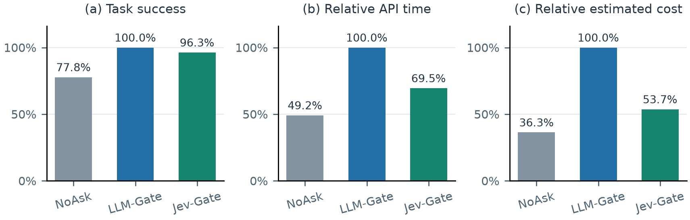

# When2Ask

**Clarification timing for robotic tasks.** CS5478 Team 11: Liang Junyi and Yang Haocheng.

When2Ask compares when a robot should ask for missing user information. A gate chooses ASK or CONTINUE before a shared planner generates a question or robot action. The benchmark covers nine manipulation, navigation, and inspection tasks in PyBullet.

[Final report](report/When2Ask_Final_Report_Illustrated.pdf) · [Presentation](ppt/When2Ask_Team11_Final.pptx) · [Demo video](ppt/When2Ask_Demo.mp4)

## Results

The main comparison uses 27 cases from 18 development layouts. API time is the mean accumulated request time per episode. Cost is estimated from recorded usage and the prices saved with the experiment.

| Method | Success | API time | Estimated cost | Unnecessary ASK |
|---|---:|---:|---:|---:|
| NoAsk | 21/27 (77.8%) | 4.05 s | $0.000718 | Not applicable |
| LLM-Gate | 27/27 (100.0%) | 8.24 s | $0.001977 | 0/18 |
| Jev-Gate | 26/27 (96.3%) | 5.73 s | $0.001062 | 0/18 |

Jev-Gate reduces API time by 30.5% and estimated cost by 46.3% relative to LLM-Gate, with one fewer successful case. The saved evaluation also includes a single-call Unified baseline. All 108 episode records are retained.



## Files

| Folder | Contents |
|---|---|
| `src/when2ask/` | Gates, planners, task environments, evaluation and API clients |
| `script/` | Setup, benchmark commands, plotting and PDF compilation |
| `data/` | Task cases and source layouts |
| `scenes/` | Base scene configurations used by the task generators |
| `result/` | Original episode logs, metrics, prices and evidence checksums |
| `graph/` | Figure data, source images and PDF/PNG/SVG figures |
| `report/` | LaTeX source, references, conference style and compiled PDF |
| `ppt/` | The final presentation and demonstration video |
| `tests/` | Offline tests for execution, information boundaries and metrics |

## Setup

Use Python 3.11 on macOS or Linux. The setup script creates a local virtual environment and checks headless PyBullet rendering. Install [uv](https://docs.astral.sh/uv/) or provide `python3.11` first.

```bash
git clone https://github.com/liangjunyi010/when2ask.git
cd when2ask
bash script/setup_env.sh
.venv/bin/python script/benchmark.py doctor
```

## Inspect and reproduce the saved evaluation

These commands do not call model APIs or require credentials.

```bash
.venv/bin/python script/benchmark.py verify
.venv/bin/python script/benchmark.py report
.venv/bin/python script/benchmark.py audit
.venv/bin/python -m pytest -q
```

Recomputed tables and the HTML result viewer are written to `result/recomputed/`. Original records remain in `result/nine_task_metrics_dev_v1/`. The checksum file covers the original results and task data. See [the experiment protocol](result/EXPERIMENT.md) for metric definitions and [the evidence notes](result/README.md) for provenance.

To check all 27 physical tasks with an offline oracle:

```bash
.venv/bin/python script/benchmark.py oracle --output result/oracle_run
```

The output directory must be new. This runs the physical tasks with known answers; it does not rerun the model comparison.

## Run a new model evaluation

Copy `.env.example` to `.env` and fill in the DeepSeek and TypeSafe credentials locally. Prepare a pricing JSON using the structure of `result/nine_task_metrics_dev_v1/pricing.json`, with the rates applicable to the new run.

```bash
cp .env.example .env
.venv/bin/python script/benchmark.py run \
  --output result/new_run --pricing /path/to/pricing.json --live
```

The runner first validates the 27 physical tasks, freezes the code and configuration, then evaluates four methods on each case. It records every request and retry. A new run can make up to 1,600 authenticated requests across 108 episodes. Existing result directories are never overwritten. Model versions, request latency and usage can differ from the saved run.

## Figures and report

```bash
.venv/bin/python script/build_figures.py
bash script/build_report.sh
```

PDF compilation requires a LaTeX installation with `latexmk` and `pdflatex`. Figures use the supplied PPT values and recorded experiment summaries. The presentation is preserved as delivered; the final report contains the completed analysis.
