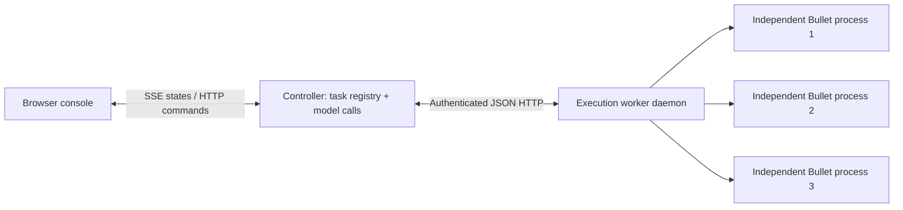

# Local live task console

The console controls real Panda execution through an HTTP worker boundary. It first runs entirely on one computer; the worker can later move to a second computer. It does not replay a GIF and does not change the frozen benchmark.

## Start and use

From the repository with the existing environment activated:

```sh
python console.py --live --output-dir outputs/local_console/my-session \
  --api-limit 60 --live-episode-limit 6
```

Open **http://127.0.0.1:8877/**. The current delivered session is already running there. There are no new Python dependencies. `python console.py` without `--live` enables only the clearly labelled offline scripted policies.

Choose a task, method and reply mode, then start a task. Starting again creates another independent world. The default limit is three simultaneous tasks; additional tasks queue. Click a camera image to enlarge it. Completed cards can be collapsed without deleting their logs.

| Selection | Behavior |
|---|---|
| Pack and Cover | Known blue cup, hidden block/lid choices; place cup, then block, then lid |
| Two Containers | Known cup and its destination; clarify block if necessary, reuse destination to choose the other container |
| LLM-NoAsk | Shared DeepSeek planner, no gate or question calls |
| LLM-Gate | DeepSeek gate before the same shared planner |
| Jev-Gate | Real Jev Noul threshold from local config, then the same planner |
| Scripted ASK / NoAsk | Explicit rule policies for free system testing; real physics, no model calls |
| Automatic replies | Existing structured User Simulator; not another LLM |
| Manual replies | The task waits for your candidate selections; “自动回答本次” answers only this question automatically |

Publicly specified choices cannot be changed by a later answer. When a previously unknown preference is answered manually, that answer defines the interactive task intent. The existing geometric evaluator uses that declared intent. Automatic episodes retain the fixed hidden demo preferences. Logs distinguish these protocols, and neither is added to the formal benchmark.

## What each card shows

- Real third-person TinyRenderer camera, simulation step, frame sequence and actual skill phase.
- Method, current state, gate decision and real Jev probability when available.
- A task-scoped question, candidate selectors and the last answer marked HUMAN or AUTO.
- Robot action count, slot-based clarification burden, measured API latency and independent physical score.
- Final episode JSON link; full raw logs remain under the session directory.

The frame packet contains JPEG bytes, SHA-256, simulation step, current action and the phase read from the real execution log. The browser decodes that image and commits its metadata together, guarded by task version. No timer drives robot animation or semantic transitions. Camera updates default to 8 FPS at 640×480; physics is paced at about 3× real time. Provider calls are bounded and logged normally.

## Process and network design



The controller holds provider credentials, the planner and per-task public histories. Every task has unique IDs for launch, command, worker event and question. Duplicate launches/answers/events cannot repeat a physical action. ASK performs no physics step; other worlds continue. Queue and concurrency limits, worker ownership, source/scene fingerprints, bounded waits and model circuit breakers are enforced.

The dedicated console inference ledger counts discovery, inference and retries. Caps persist in the session directory. Its internal `policy: phase2` value is the reused accounting primitive, not the historical Phase 2 ledger. A provider failure is visible and does not silently switch a real method to a script. Defaults: 20 rounds, 12 robot actions, 12 requested slots, 64 per-episode API attempts, 60 shared authenticated calls and 6 live episodes per session. Raising a cap or using a fresh session is an explicit operator action.

The controller binds only localhost by default. Mutations reject cross-origin requests and unrecognized Host headers. Worker RPC requires a separate random bearer token, stored with mode 0600 in the ignored session directory. Model keys never go to the browser or worker.

## Later: two computers over VPN

This path is implemented but **not yet tested across physical computers**. The same revision, Python 3.11 environment and PyBullet assets must be present on both machines. Computer B needs no DeepSeek/Jev keys. A browser on computer A continues to use localhost; only worker traffic traverses the VPN.

On controller A, use its actual VPN address as the allowed host:

```sh
python console.py --live --host 0.0.0.0 --advertise-host <A_VPN_IP> \
  --no-local-worker --output-dir outputs/local_console/vpn-session
```

Transfer only that session's `worker.token` through a private channel to B, with file mode 0600. On B:

```sh
python console.py worker --server http://<A_VPN_IP>:8877 \
  --token-file /private/path/worker.token --capacity 3
```

Do not expose this HTTP service to the public internet. VPN encryption supplies transport protection. A local plus remote worker can also share the global concurrency cap. This is a small distributed execution prototype with a single controller, not a replicated/high-availability scheduler.

## Evidence and limitations

See [the measured validation report](../outputs/console_evidence/README.md) and screenshots. Real-browser checks exercised concurrent worlds, manual intent, an unchanged ASK snapshot, continued progress elsewhere, refresh/reconnect, queue cancellation, duplicate submission, image/metadata equality and full-view display. Three additional real-model episodes were run and their genuine failures are retained.

The original 102 tests plus 24 new console tests pass. Offline pytest does not call providers. Browser integration scripts are explicit standalone commands; `console_live_check.mjs` additionally requires `--live` and the matching session path.

Browser reconnect is supported. A full controller restart retains files and budget, but does not reload task cards or resume partial grasps. Worker/controller crash recovery, reliable remote reconnection mid-action, and two-computer VPN behavior remain future work. A pending manual question times out after 30 minutes; cancellation during a provider request waits for its bounded timeout. This release does not claim physical fault tolerance.
