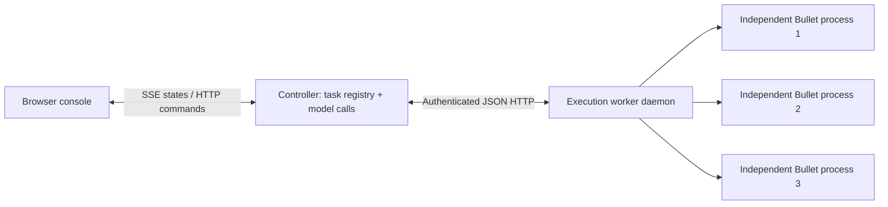

# Local live task console

The console controls real Panda execution through an HTTP worker boundary. It first runs entirely on one computer; the worker can later move to a second computer. It does not replay a GIF and does not change the frozen benchmark.

## Start and use

From the repository with the existing environment activated:

```sh
python console.py --live --output-dir outputs/local_console/my-session \
  --api-limit 60 --live-episode-limit 6
```

Open **http://127.0.0.1:8877/**. The current delivered session is already running there. There are no new Python dependencies. `python console.py` without `--live` enables only the clearly labelled offline scripted policies.

Choose a task, method and reply mode, then start a task. Starting again creates another independent world. The default limit is three simultaneous tasks; additional tasks queue. Click a camera image to enlarge it. Completed cards can be collapsed without deleting their logs.

| Selection | Behavior |
|---|---|
| Pack and Cover | Known blue cup, hidden block/lid choices; place cup, then block, then lid |
| Two Containers | Known cup and its destination; clarify block if necessary, reuse destination to choose the other container |
| LLM-NoAsk | Shared DeepSeek planner, no gate or question calls |
| LLM-Gate | DeepSeek gate before the same shared planner |
| Jev-Gate | Real Jev Noul threshold from local config, then the same planner |
| Scripted ASK / NoAsk | Explicit rule policies for free system testing; real physics, no model calls |
| Automatic replies | Existing structured User Simulator; not another LLM |
| Manual replies | The task waits for your candidate selections; “自动回答本次” answers only this question automatically |

Publicly specified choices cannot be changed by a later answer. When a previously unknown preference is answered manually, that answer defines the interactive task intent. The existing geometric evaluator uses that declared intent. Automatic episodes retain the fixed hidden demo preferences. Logs distinguish these protocols, and neither is added to the formal benchmark.

## What each card shows

- Real third-person TinyRenderer camera, simulation step, frame sequence and actual skill phase.
- Method, current state, gate decision and real Jev probability when available.
- A task-scoped question, candidate selectors and the last answer marked HUMAN or AUTO.
- Robot action count, slot-based clarification burden, measured API latency and independent physical score.
- Final episode JSON link; full raw logs remain under the session directory.

The frame packet contains JPEG bytes, SHA-256, simulation step, current action and the phase read from the real execution log. The browser decodes that image and commits its metadata together, guarded by task version. No timer drives robot animation or semantic transitions. Camera updates default to 8 FPS at 640×480; physics is paced at about 3× real time. Provider calls are bounded and logged normally.

## Process and network design



The controller holds provider credentials, the planner and per-task public histories. Every task has unique IDs for launch, command, worker event and question. Duplicate launches/answers/events cannot repeat a physical action. ASK performs no physics step; other worlds continue. Queue and concurrency limits, worker ownership, source/scene fingerprints, bounded waits and model circuit breakers are enforced.

The dedicated console inference ledger counts discovery, inference and retries. Caps persist in the session directory. Its internal `policy: phase2` value is the reused accounting primitive, not the historical Phase 2 ledger. A provider failure is visible and does not silently switch a real method to a script. Defaults: 20 rounds, 12 robot actions, 12 requested slots, 64 per-episode API attempts, 60 shared authenticated calls and 6 live episodes per session. Raising a cap or using a fresh session is an explicit operator action.

The controller binds only localhost by default. Mutations reject cross-origin requests and unrecognized Host headers. Worker RPC requires a separate random bearer token, stored with mode 0600 in the ignored session directory. Model keys never go to the browser or worker.

## Later: two computers over VPN

This path is implemented but **not yet tested across physical computers**. The same revision, Python 3.11 environment and PyBullet assets must be present on both machines. Computer B needs no DeepSeek/Jev keys. A browser on computer A continues to use localhost; only worker traffic traverses the VPN.

On controller A, use its actual VPN address as the allowed host:

```sh
python console.py --live --host 0.0.0.0 --advertise-host <A_VPN_IP> \
  --no-local-worker --output-dir outputs/local_console/vpn-session
```

Transfer only that session's `worker.token` through a private channel to B, with file mode 0600. On B:

```sh
python console.py worker --server http://<A_VPN_IP>:8877 \
  --token-file /private/path/worker.token --capacity 3
```

Do not expose this HTTP service to the public internet. VPN encryption supplies transport protection. A local plus remote worker can also share the global concurrency cap. This is a small distributed execution prototype with a single controller, not a replicated/high-availability scheduler.

## Evidence and limitations

See [the measured validation report](../outputs/console_evidence/README.md) and screenshots. Real-browser checks exercised concurrent worlds, manual intent, an unchanged ASK snapshot, continued progress elsewhere, refresh/reconnect, queue cancellation, duplicate submission, image/metadata equality and full-view display. Three additional real-model episodes were run and their genuine failures are retained.

The original 102 tests plus 24 new console tests pass. Offline pytest does not call providers. Browser integration scripts are explicit standalone commands; `console_live_check.mjs` additionally requires `--live` and the matching session path.

Browser reconnect is supported. A full controller restart retains files and budget, but does not reload task cards or resume partial grasps. Worker/controller crash recovery, reliable remote reconnection mid-action, and two-computer VPN behavior remain future work. A pending manual question times out after 30 minutes; cancellation during a provider request waits for its bounded timeout. This release does not claim physical fault tolerance.

## Robot Command Center upgrade — 2026-11-06

The same local URL now opens a dark mission-control interface with a robot wall, system overview, task-specific execution trace, real Jev probability display and a unified clarification desk. All semantic transitions come from versioned controller/worker events; camera frames retain the JPEG/step/phase synchronization contract. Failure scores stay visible in red.

**One-click comparison:** choose a task and 0–3 unknown preferences, then click “一键三方法对比”. This creates LLM-NoAsk, LLM-Gate and Jev-Gate with the same physical layout, scene seed, initial instruction, fixed hidden preferences, shared planner configuration and prompt hashes. Each has its own world/history. Replies are always automatic; human intent-setting tasks are launched separately. Comparison metadata and measured JSON/CSV are saved under the session's `comparisons/` directory. Click the CSV/JSON links in the results panel. A `?comparison=<id>` link and browser reload retain the chosen group while the controller is running.

The three live episode slots are reserved atomically. Insufficient budget, missing credentials, a blocked backend or insufficient queue room rejects the group. There is no scripted replacement for a real method. Each model attempt is reserved in the same shared ledger before the network call; retries count normally. A discovered batch-binding bug was fixed and documented in the new evidence rather than hiding its first development run.

**Unified queue:** pending questions from all tasks appear on the right. Click a task to answer its exact question. Candidate selections survive switching and browser reload; submitting uses the captured Task ID + Question ID. “自动回答本次” answers that question only. An accepted duplicate is ignored, and a question from another task is rejected. Only the questioning physical world freezes. Burden is charged when a question is issued, even if it later times out or is cancelled.

**Disclosure profiles:** 0–3 unknown preferences are derived in memory on the two validated Dev layouts, without modifying data files or reading held-out Test. The existing default demo choices remain compatible. Initial disclosed preferences are selected in a deterministic order; these interactive profiles are not claimed to be a new balanced benchmark distribution.

New local API endpoints:

| Endpoint | Purpose |
|---|---|
| `POST /api/comparisons` | Atomic three-method launch with an idempotent request ID |
| `GET /api/comparisons` | Current in-memory comparison groups |
| `GET /api/comparisons/<id>` | Metadata, real scores and per-backend inference costs |
| `GET /api/comparisons/<id>/csv` | Completed measured comparison download |
| `GET /api/clarifications` | Authoritative task-scoped pending questions |

Current browser checks: `node scripts/command_center_check.mjs` (real physics, no provider calls). Paid checks additionally require `--live --session-dir <matching-session>`. The previous browser-check entry points forward to this version and write new evidence under `outputs/command_center_evidence/`; they do not overwrite the published v1 artifacts. `python scripts/report_command_center.py` rebuilds the new report offline. The earlier `report_console.py` remains for the earlier evidence only.

See [new measured results and screenshots](../outputs/command_center_evidence/README.md). Two-computer VPN testing remains deferred.

## Navigation Dev v1

Select **Find & Approach · 三房间找物** in the same HTML. The Husky searches six
stations in a known three-room map using wheel motors and local range/FOV/LOS
observations. Auto/manual replies provide a fixed-world location hint; manual answers
never relocate the object or change the evaluator. One-click comparison still launches
three independent real-model worlds. Navigation cards and comparison rows add actual
travel distance and inspected station count. See [task contract and commands](navigation_dev_v1.md)
and [actual bounded pilot](../outputs/navigation_dev_v1/live_v1/README.md).

## Manual replies and complete task review

Human mode chooses who answers **after a real ASK**; it does not force the Gate to ask. NoAsk never asks. The “自动三方法对比” button always uses automatic responses; launch an individual task for Human mode. If no question is pending, the queue explains the selected task's actual mode/Gate status rather than implying a missing input box.

A pending question accepts explicit object names/colors/IDs as text (for example `green block, black lid`), or candidate dropdowns. Ambiguous text is rejected; this is bounded structured grounding without an extra LLM call. Navigation requires a complete station such as “客厅柜子”; “客厅” alone is ambiguous.

Each card's **指令 · 完整对话 · Ground Truth** button opens the original generated instruction, a public ID/name legend, the entire chronological conversation/action history and physical scoring conditions. The sidebar Queue is for pending questions only. After termination the card also shows the evaluated goal. Full hidden reference and effective scoring goals are shown in the modal; human tabletop choices may define interactive intent, while navigation facts remain fixed. No hidden truth is included in model input.

Completed task views persist in `review.json`/`final_view.json` and reload read-only after controller restart. Active-world crash recovery is still unsupported. Current HTML uses the existing tabletop contract and navigation v1; the Navigation Dev v2 report remains a separate research artifact. [Actual three-run verification](../outputs/console_review_v1/README.md).

## Named DAG presentation presets

The tabletop launcher now offers ten presets per template (twenty total). Selecting a preset fixes its disclosure count, public ordering constraints, seed, object aliases and initial instruction. It uses the same scene and preference definitions on controller and worker; preset/template/disclosure mismatches are rejected. Free demonstration remains available, and navigation keeps its existing scenario selector. Both single-task and three-method comparison launches preserve the selected preset.

The preview/episode details display the public DAG, without hidden choices. These observer-facing diagrams do not change the agent payload. Human mode continues to wait for an actual ASK rather than forcing a question. A read-only result gallery is available at http://127.0.0.1:8881/ and launches no model calls. See [scenario collection and evidence](presentation_dag_scenarios_v1.md).
