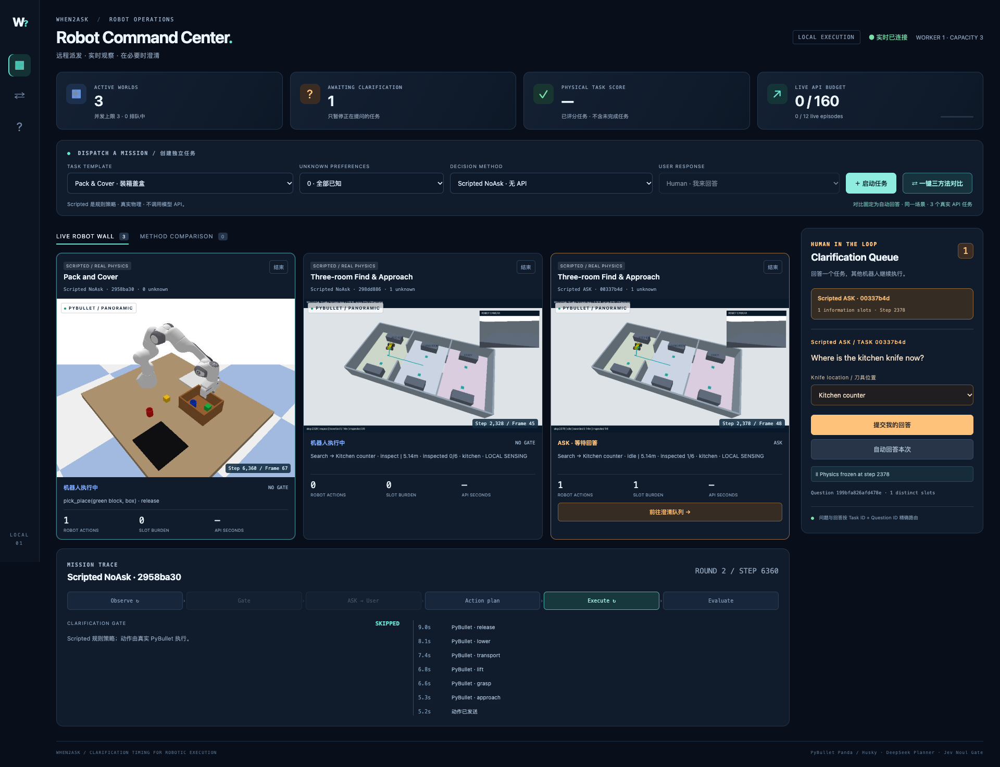
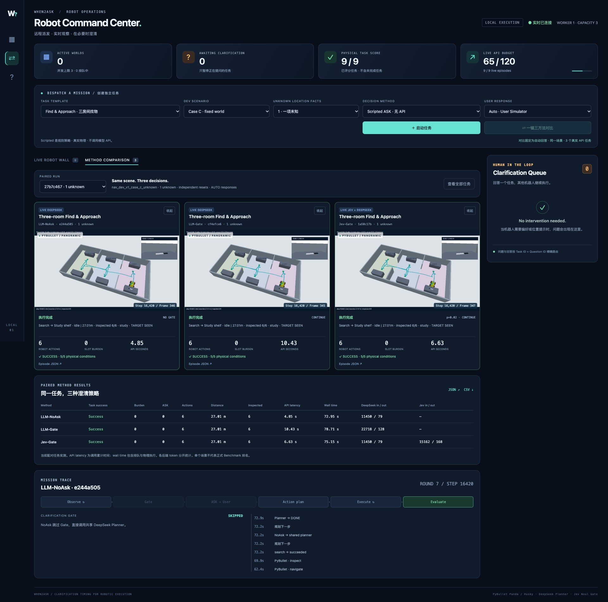

# Navigation Dev v1 — local implementation and evidence

New task: **three-room find and approach**, independent of frozen tabletop experiments.

- [Real DeepSeek/Jev pilot: plan, report, raw JSON/JSONL and CSV](live_v1/README.md).
- [Oracle/scripted real-physics checks](oracle/summary.json): 9/9 completed, all physical actions succeeded.
- [Real Chromium manual-navigation / concurrent Panda regression](browser/validation.json).
- [Separate automatic reply / 3s delay / responsive-browser check](browser/auto_validation.json).
- [Full offline pytest XML](pytest.xml): 205 passed, original 181 unchanged.
- [Paired-state, request ledger and protected-file integrity](live_v1/integrity.json).
- [Task contract, limitations, asset license and reproduction](../../docs/navigation_dev_v1.md).

Interactive controller: http://127.0.0.1:8877/?template=find_and_approach

Completed live comparison: http://127.0.0.1:8878/?comparison=27b7c467d0ff4527

Both are local running services, not Internet hosting. The paid pilot session has used
9/9 episode slots and cannot silently launch another paid comparison. The independent
interactive session has its own explicit request cap; scripted runs use no paid calls.

The three placements belong to **one map group**. Live model results: each method 3/3,
burden 0; no learned-gate ASK was observed. Real ASK and user-reply evidence comes
from explicitly scripted UI/physics checks. There is no held-out Test conclusion,
learned-vision claim, grasp/delivery capability, hardware or two-computer validation.

Screenshots:

